<p align="center">
  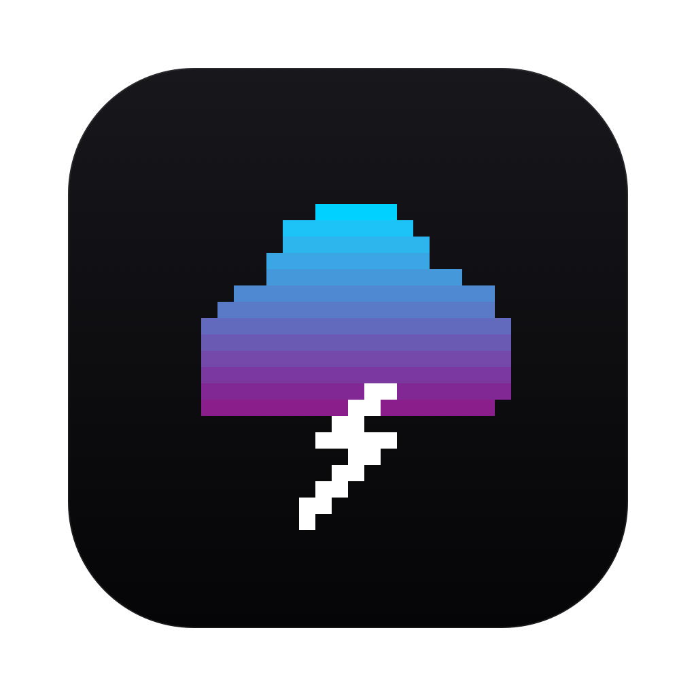
</p>

<h1 align="center">Applarchy</h1>

<p align="center">
  <b>Omarchy's terminal-art screensaver, reborn on macOS.</b><br>
  37 pixel-art text effects over the Apple logo — as a screensaver or a live wallpaper.
</p>

<p align="center">
  <a href="https://github.com/CaptainCompileon/applarchy/releases/latest"></a>
  
  
  
</p>

<p align="center">
  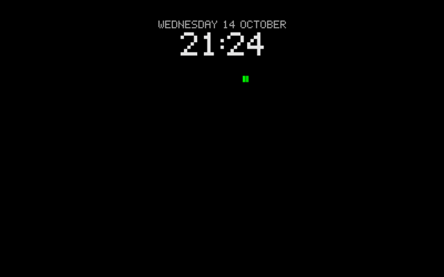
  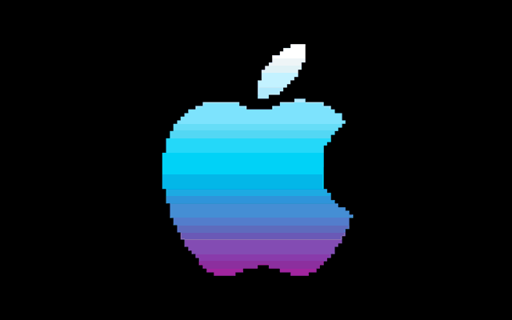
</p>

---

[Omarchy](https://github.com/basecamp/omarchy) ships a screensaver that plays random effects from
[TerminalTextEffects](https://github.com/ChrisBuilds/terminaltexteffects) over its logo, in a
terminal. **Applarchy** brings the same effects to the Mac — not in a terminal window, but as a
real macOS screensaver and as a live desktop wallpaper, with the effect engine compiled right in.

## Features

- **All 37 effects** — beams, matrix rain, thunderstorms, fireworks, black holes, decrypt and more,
  rendered from the same engine Omarchy uses.
- **Pick your mix** — one effect, a handful, or all of them. Your picks play in random order, each
  once before any repeats.
- **Screensaver** — appears in System Settings → Screen Saver, with an optional pixel-font clock.
- **Live wallpaper** — runs behind your desktop icons on every screen and Space, and pauses itself
  whenever the desktop is covered, the display sleeps or the screensaver runs.
- **Themes** — Omarchy's own colours or eight of its themes: Tokyo Night, Catppuccin, Gruvbox, Nord,
  Everforest, Kanagawa, Rosé Pine and Matte Black. A theme recolours the effects, the background and
  the clock.
- **Choose your vibe** — *Chill Guy* (small logo), *Apple Evangelist* (big logo), or your **own logo**
  from any picture or pasted text art.
- **Clock options** — 12- or 24-hour (or follow the system), with or without the date, small or
  large.
- **Smooth or easy on the battery** — the wallpaper runs at 120, 60, 30 or 15 fps, or **Auto**:
  each display's own refresh rate (up to 120), and can pause on battery power or in Low Power Mode.
- **Reduce Motion aware** — with macOS's Reduce Motion on, only the calm effects play.
- **Update notices** — a note in the app and the menu bar when a new version is out.
- **Universal** — runs natively on Apple Silicon and Intel Macs.
- **Live preview** of any effect, a quick first-run tour, and a pixel menu bar item to pause or stop
  the wallpaper.
- **Pixel-perfect UI** — one pixel typeface, square controls and hard shadows throughout, to match
  the effects.

## Screenshots

<p align="center">
  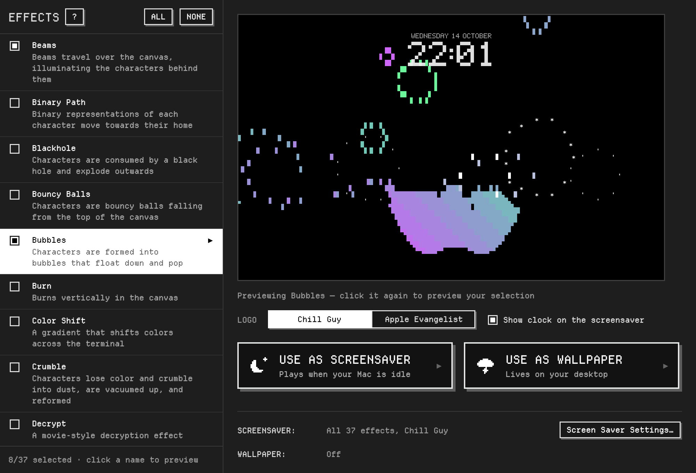
</p>
<p align="center">
  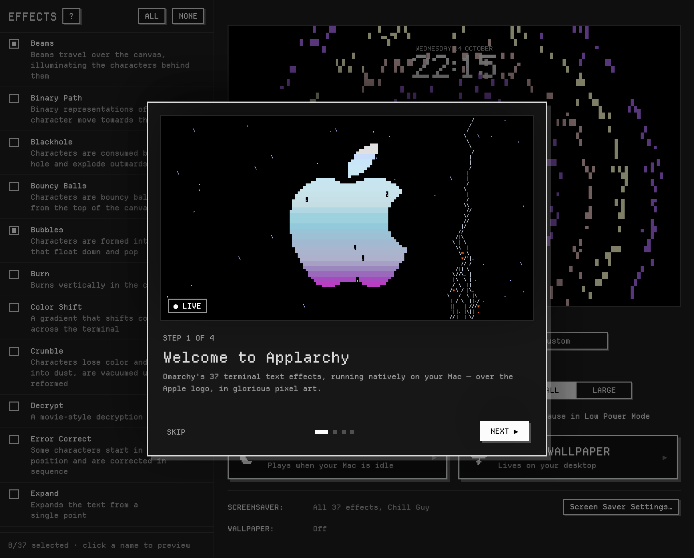
</p>

### Themes

<p align="center">
  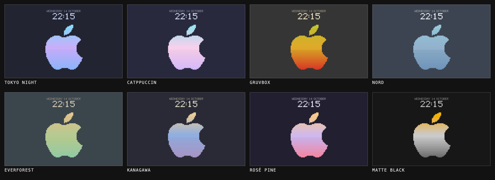
</p>

### Your own logo

<p align="center">
  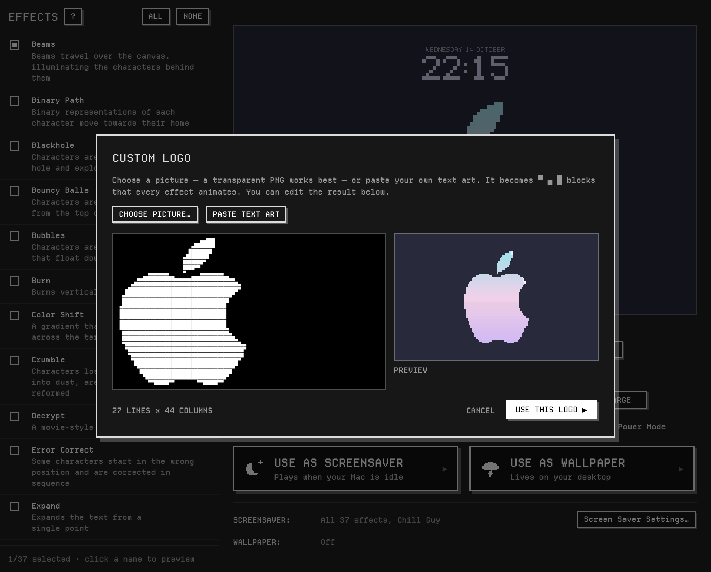
</p>

### A few of the effects

| | | | |
|:-:|:-:|:-:|:-:|
| 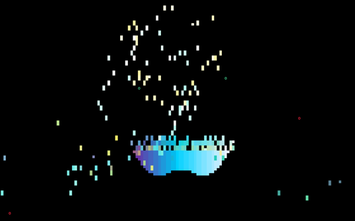<br>Fireworks | 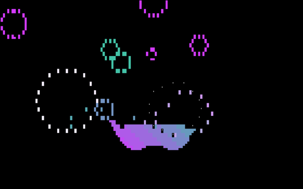<br>Bubbles | 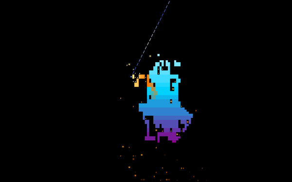<br>Laser Etch | 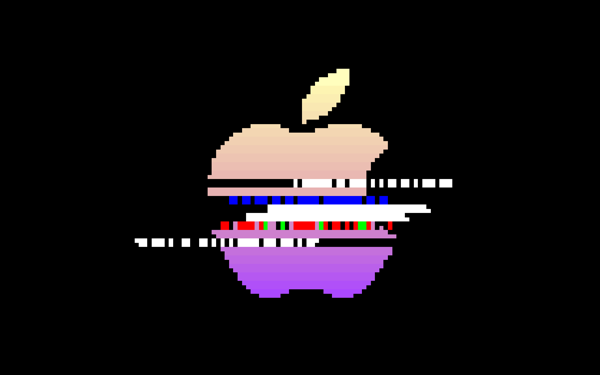<br>VHS Tape |
| 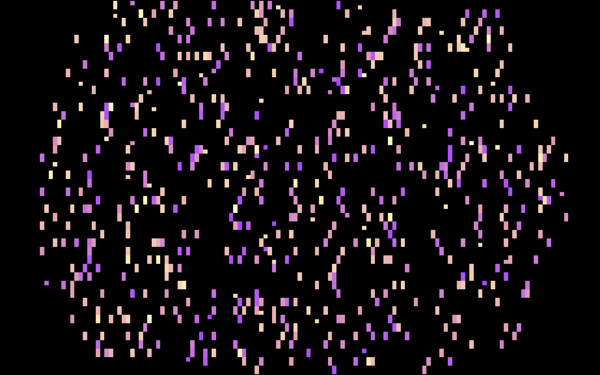<br>Rings | 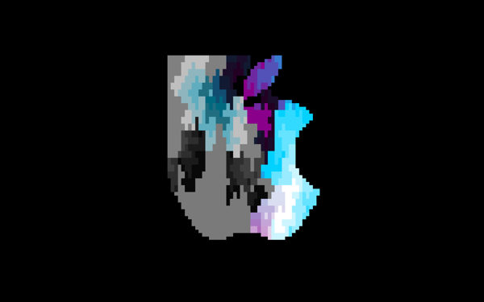<br>Smoke | 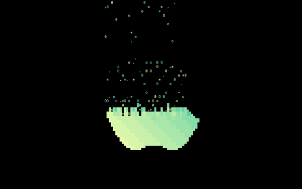<br>Bouncy Balls | 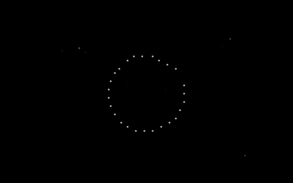<br>Black Hole |

<p align="center">
  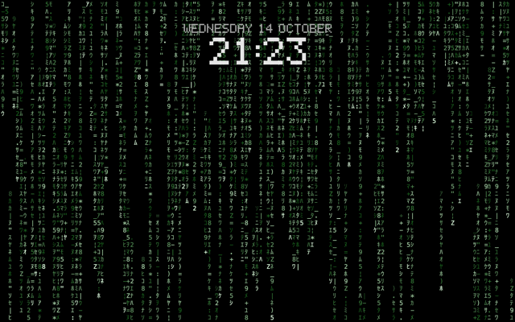
</p>

<details>
<summary><b>All 37 effects</b></summary>

Beams · Binary Path · Blackhole · Bouncy Balls · Bubbles · Burn · Color Shift · Crumble · Decrypt ·
Error Correct · Expand · Fireworks · Highlight · Laser Etch · Matrix · Middle Out · Orbiting Volley ·
Overflow · Pour · Print · Rain · Random Sequence · Rings · Scattered · Slice · Slide · Smoke ·
Spotlights · Spray · Swarm · Sweep · Synth Grid · Thunderstorm · Unstable · VHS Tape · Waves · Wipe

</details>

## Install

1. Download **`Applarchy-<version>.dmg`** from the [latest release](https://github.com/CaptainCompileon/applarchy/releases/latest).
2. Open it and drag **Applarchy** into **Applications**.
3. Open Applarchy from Applications.

> **First launch:** Applarchy isn't signed with an Apple Developer ID, so macOS will refuse to open
> it the first time. Open **System Settings → Privacy & Security**, scroll down to the message about
> Applarchy, and click **Open Anyway**. You only need to do this once.
>
> Alternatively, in Terminal:
> ```bash
> xattr -dr com.apple.quarantine /Applications/Applarchy.app
> ```

**Requirements:** macOS 13 Ventura or later, on Apple Silicon or Intel.

## Usage

1. **Pick effects** — tick the ones you like. Click an effect's name to preview just that one.
2. **Choose your look** — the logo (*Chill Guy*, *Apple Evangelist* or **Custom**: pick a picture or
   paste text art), a theme, and the clock options.
3. Click **Use as Screensaver** or **Use as Wallpaper**.
   - The first time you set the screensaver, macOS asks to install it — click **Install**. Then pick
     **Applarchy** under *Other* in System Settings → Screen Saver. After that, Applarchy updates
     the installed screensaver directly; changes show the next time it starts.
   - The wallpaper starts right away and comes back when you log in. Pause it or turn it off from
     the storm-cloud icon in the menu bar. Its frame rate and battery options apply instantly.

> **Tip:** the screensaver draws its own pixel clock. To avoid two clocks on top of each other, set
> **System Settings → Lock Screen → Show large clock** to **On Lock Screen** (or **Never**).

## Build from source

You need the Xcode Command Line Tools (`xcode-select --install`) and Rust
([rustup](https://rustup.rs) or `brew install rust`).

```bash
git clone https://github.com/CaptainCompileon/applarchy.git
cd applarchy
scripts/dev.sh            # build, install to ~/Applications and open "Applarchy DEV"
```

Local builds are **Applarchy DEV**: a separate app with its own settings, login item and
screensaver ("Applarchy DEV" in Screen Saver settings), so you can test it next to an installed
Applarchy. Its window title shows the commit it was built from. In VS Code, ⇧⌘B runs
`scripts/dev.sh`. To build the released app instead:

```bash
APPLARCHY_FLAVOR=release scripts/build.sh          # → dist/Applarchy.app
APPLARCHY_FLAVOR=release scripts/package-dmg.sh    # → dist/Applarchy-<version>.dmg
```

Without `APPLARCHY_FLAVOR=release`, `scripts/build.sh` and `scripts/package-dmg.sh` produce
`dist/Applarchy DEV.app` and `dist/Applarchy-DEV-<version>.dmg`.

Builds are **universal** (Apple Silicon + Intel) when [rustup](https://rustup.rs) has the Intel target
(`rustup target add x86_64-apple-darwin`), and Apple Silicon only otherwise. Every version tag is
also built on GitHub Actions, which attaches the DMG to the release.

### Signing and notarization (maintainers)

With a paid Apple Developer account, `scripts/sign-and-notarize.sh` signs the app with your
Developer ID, notarizes the DMG with Apple and staples the ticket, so it opens without the
"Open Anyway" step. See the script for the one-time setup.

## How it works

```
engine/   ttfx — the Rust port of TerminalTextEffects that Omarchy uses — plus a small C API
          that builds an effect on a fixed canvas and hands out frames one at a time
saver/    a native ScreenSaverView: parses each frame's ANSI cells and draws them as pixel art
          (block characters as exact rectangles, glyphs with Core Text), plus the pixel clock
studio/   the app: SwiftUI front end, live preview, wallpaper windows, screensaver installer
```

- A **theme** is a set of ttfx options: the gradient the logo settles into (`--final-gradient-stops`),
  each effect's signature colours (beams, rain, lightning, fireworks…) and the background colour.
- The **logo** isn't shipped as artwork: it's drawn at runtime from your Mac's own system font
  (the `` character, U+F8FF) and resampled into half-block pixels.
- The **screensaver** (`Applarchy.saver`) reads its settings from `Resources/config.json` inside
  its own bundle, which the sandboxed screensaver host can always read. The app updates that file
  in place, so changes don't need another install.
- The **wallpaper** is a borderless window per screen at desktop level, behind the icons, that
  ignores the mouse. It draws into an 8-bit offscreen bitmap at 1× and lets the compositor scale
  it up nearest-neighbour — crisp pixel art at a fraction of the cost of redrawing a Retina,
  wide-colour backing store every frame.
- Effects run at Omarchy's 120 fps pace whatever the frame rate (a tick's leftover fraction of an
  engine frame carries over, so 75 or 90 Hz keep the pace too). The screensaver runs at each
  display's refresh rate (`maximumFramesPerSecond`, capped at the engine's 120, or 60 when macOS
  doesn't report one); the wallpaper at 120, 60, 30 (the default) or 15 fps, or Auto, the same rule.
- The layout (text size, logo, clock) scales to whichever of the screen's width or height is
  tighter, so ultrawide and portrait displays look like a laptop's, with more room around them.

## Privacy

Applarchy makes one network request: once a day it asks GitHub's public API for the latest
release, to tell you about updates. Nothing about you or your Mac is sent.

## Uninstall

1. In Applarchy's ⛈ menu, choose **Turn Off Wallpaper**, then **Quit Applarchy**.
2. Delete **Applarchy** from Applications.
3. Remove the screensaver: delete `Applarchy.saver` from `~/Library/Screen Savers` or, if you
   installed it for all users, `/Library/Screen Savers`.

## Credits

- **[TerminalTextEffects](https://github.com/ChrisBuilds/terminaltexteffects)** by ChrisBuilds —
  every effect is their design.
- **[ttfx](https://github.com/omacom/ttfx)** by omacom — the Rust port embedded here (MIT; see
  [`engine/LICENSE`](engine/LICENSE) and [`engine/NOTICE`](engine/NOTICE)).
- **[Omarchy](https://github.com/basecamp/omarchy)** by Basecamp — the screensaver that inspired
  this.
- **[Departure Mono](https://departuremono.com)** by Helena Zhang — the app's pixel typeface
  (SIL Open Font License 1.1; see [`studio/fonts/DepartureMono-LICENSE.txt`](studio/fonts/DepartureMono-LICENSE.txt)).

## License

[MIT](LICENSE).

Applarchy is a fan project and is not affiliated with, endorsed by or sponsored by Apple Inc. or
Basecamp. Apple and the Apple logo are trademarks of Apple Inc., registered in the U.S. and other
countries. Omarchy is a project by Basecamp.
